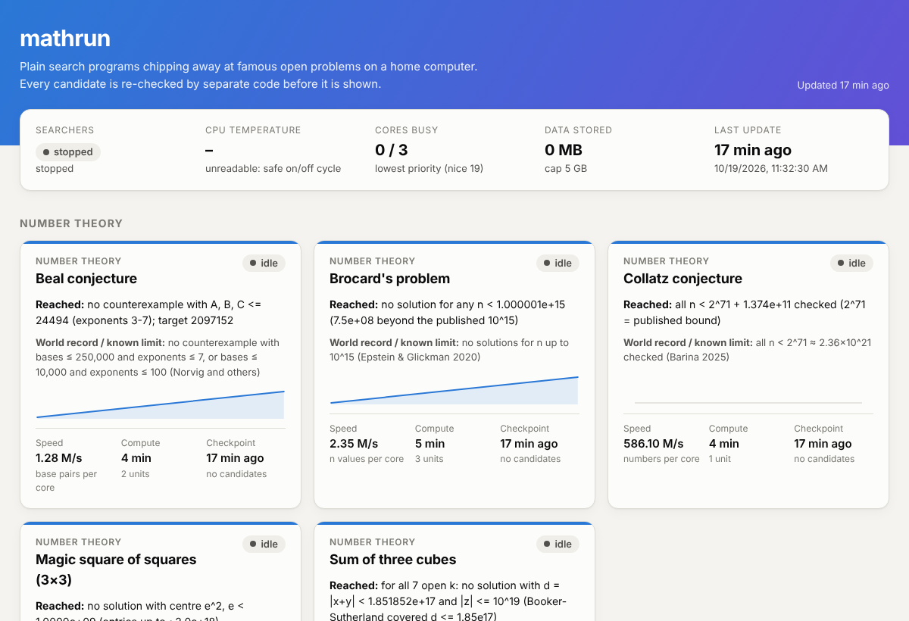

# mathrun

**Plain, AI-free search programs chipping away at famous open maths problems on a home computer.**

The thinking was done once, up front: choosing the problems, checking their current status, finding the best known methods, and writing fast searchers with tests. After that, ordinary C programs grind away for free whenever the computer is on. They pause when it's hot, busy or in gaming mode, and carry on where they left off. A dashboard shows how far each one has got.



## The problems

| Problem | Searches | Starts at | Honest odds |
|---|---|---|---|
| [Fast matrix multiplication](problems/matrix-multiplication/README.md) | Fewer multiplications for 3×3, 4×4, 5×5 and 14 rectangular shapes (flip graphs over GF(2), then a lift to integers) | Best scheme found so far | Low, but ordinary PCs still set records here |
| [Brocard's problem](problems/brocard/README.md) | n! + 1 = m² | n = 10^15 (published bound) | No new solution expected; extends the verified bound |
| [Sum of three cubes](problems/sum-of-three-cubes/README.md) | x³+y³+z³ = 114, 390, 627, 633, 732, 921, 975 | Just past Booker & Sutherland's 2020 search | Lottery ticket |
| [Perfect cuboid](problems/perfect-cuboid/README.md) | A box with all 7 lengths whole | Odd edge 2.5×10^13 | Very low |
| [Beal conjecture](problems/beal/README.md) (US$1M) | A^x+B^y=C^z, coprime, exponents ≥ 3 | Bases up to 2^21 (8× published) | Essentially zero |
| [Magic square of squares](problems/magic-square-of-squares/README.md) | 3×3 magic square of 9 squares | From the start (no precise published bound) | Low |
| [Collatz conjecture](problems/collatz/README.md) | Numbers that never reach 1 | 2^71 | Essentially zero |
| [Cap sets](problems/cap-sets/README.md) | Big caps in F₃⁷ and F₃⁸ | Best cap found so far | Practically none (low weight) |

How these were chosen, and why 15 other famous problems were left out, is in [docs/problem-shortlist.md](docs/problem-shortlist.md).

## Correctness first

- Every searcher re-finds known results in its tests. Examples: Strassen's 7 and Laderman's 23 multiplications, the famous 33, 42 and 3 three-cube solutions, Brocard's 4, 5 and 7, the smallest Euler brick, the SET-card cap of 20.
- Every candidate is saved at once, then checked by a **separate verifier written differently** (exact Python integers). Only then is it shown as **"VERIFIED CANDIDATE — needs human review"**. A candidate the verifier rejects pauses that searcher as a suspected bug.
- The dashboard only ever claims the range that has *certainly* been finished, and marks it "UNTRUSTED" if a searcher was ever caught out.
- Independent code reviews were run on every searcher and on the safety code. All findings were fixed (see the log in [CLAUDE.md](CLAUDE.md)).

## Safety

- Lowest CPU and disk priority; all cores but one by default.
- Pauses above 85 °C, in gaming mode, or (optionally) while you're using the computer.
- 5 GB data cap, and saving that can't be corrupted.
- No GitHub Actions. No network access from the searchers. Nothing written outside this folder, except an optional autostart file.
- Publishing to GitHub Pages is off by default. When on, it pushes one small status commit at most hourly, and never touches your own checkout.

## Get started

See **[SETUP.md](SETUP.md)**. In short:

```bash
git clone https://github.com/JacobGoodchild/mathrun.git && cd mathrun
./mathrun install && ./mathrun selftest && ./mathrun start && ./mathrun dashboard
```

To add a problem, see [ADDING_A_PROBLEM.md](ADDING_A_PROBLEM.md). Third-party code (only mini-gmp) is listed in [CREDITS.md](CREDITS.md).
